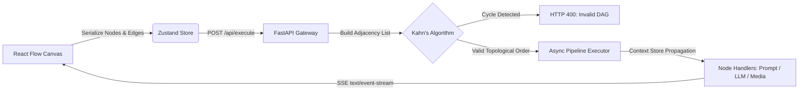

# Conduit

**Visual Directed Acyclic Graph (DAG) Workflow Engine & AI Pipeline Orchestrator**


Conduit is a spatial, node-based workflow execution engine that allows developers to visually wire prompts, LLM inference nodes, and media processing steps into automated pipelines. 

Instead of relying on rigid linear scripts, Conduit serializes visual node graphs from the browser into an adjacency structure, validates acyclic integrity on the backend using **Kahn's Algorithm**, and streams live per-node execution states back to the canvas over **Server-Sent Events (SSE)**.

---

## System Architecture



### Core Engineering Mechanics

1. **Topological Sorting & Cycle Detection ($O(V + E)$)**
   User-constructed graphs are untrusted and may contain circular dependencies (e.g., `Node A -> Node B -> Node A`). Before executing any compute task, the FastAPI engine builds an in-degree map and adjacency list, executing **Kahn's Algorithm** via a `collections.deque` queue. If the resolved execution order length does not match the total vertex count, Conduit immediately aborts execution to prevent infinite loops.

2. **Context Propagation Store**
   As the executor iterates through the topologically sorted node IDs, each completed node writes its output artifact into an isolated in-memory `context_store`. Downstream child nodes automatically resolve and inject upstream parent outputs before firing their own execution handlers.

3. **Real-Time Telemetry via Server-Sent Events (SSE)**
   Rather than polling the backend for job status, Conduit maintains an open `text/event-stream` HTTP connection during pipeline execution. As each node transitions through `RUNNING` $\rightarrow$ `COMPLETED`, the backend yields newline-delimited JSON frames that update the React Flow node borders and output inspectors with sub-millisecond UI latency.

4. **Spatial DevTool Interface (Onyx & Alabaster)**
   Engineered with Next.js (App Router), `@xyflow/react`, Zustand, and Tailwind CSS. Memoized custom node primitives prevent unnecessary canvas re-renders during high-frequency state updates.

---

## Repository Structure

```text
conduit/
├── backend/
│   ├── main.py              # FastAPI server, CORS config, SSE streaming endpoint
│   ├── dag.py               # Kahn's Algorithm topological sort & cycle detector
│   ├── schemas.py           # Pydantic validation models for Nodes, Edges, and DAG payloads
│   └── requirements.txt     # Python dependencies
└── frontend/
    ├── src/
    │   ├── app/             # Next.js App Router workspace & global styles
    │   ├── components/      # Custom React Flow nodes (Prompt, LLM, Output) & TopBar
    │   └── store/           # Zustand state management & SSE stream reader
    └── package.json
```

---

## Local Development Setup

### Prerequisites
* **Node.js** `>= 18.x`
* **Python** `>= 3.10`

### 1. Start the FastAPI DAG Engine
```bash
cd backend
python3 -m venv venv
source venv/bin/activate
pip install -r requirements.txt
uvicorn main:app --reload --port 8000
```
*Health Check:* `GET http://localhost:8000/health`  
*Interactive API Docs:* `http://localhost:8000/docs`

### 2. Start the Spatial Frontend
```bash
cd frontend
npm install
npm run dev
```
Open `http://localhost:3000` in your browser to access the Conduit workspace.

---

## API Specification

### `POST /api/execute`
Accepts a serialized React Flow graph and streams execution events.

**Request Payload:**
```json
{
  "nodes": [
    { "id": "node-1", "type": "promptNode", "data": { "prompt": "Explain distributed task queues" } },
    { "id": "node-2", "type": "llmNode", "data": { "model": "Llama-3.3-70B", "system": "Summarize in 3 bullets" } },
    { "id": "node-3", "type": "outputNode", "data": {} }
  ],
  "edges": [
    { "id": "e1-2", "source": "node-1", "target": "node-2" },
    { "id": "e2-3", "source": "node-2", "target": "node-3" }
  ]
}
```

**SSE Stream Response (`text/event-stream`):**
```text
data: {"node_id": "node-1", "status": "RUNNING"}
data: {"node_id": "node-1", "status": "COMPLETED", "output": "Explain distributed task queues"}
data: {"node_id": "node-2", "status": "RUNNING"}
data: {"node_id": "node-2", "status": "COMPLETED", "output": "• Decouples heavy compute...\n• Uses message brokers...\n• Scales horizontally..."}
data: {"node_id": "node-3", "status": "RUNNING"}
data: {"node_id": "node-3", "status": "COMPLETED", "output": "• Decouples heavy compute...\n• Uses message brokers...\n• Scales horizontally..."}
data: {"event": "PIPELINE_COMPLETE"}
```

---

## License

MIT License — Engineered by **[Sreerag P P](https://sreerag.dev)** ([GitHub](https://github.com/sreeragpp86) | [LinkedIn](https://linkedin.com/in/sreeragpp))

